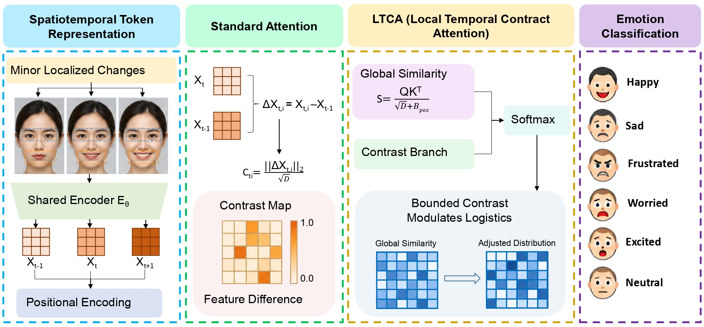

# LTCA: A Lightweight Attention Mechanism in Video Transformers for Facial Emotion Recognition


# Overview

Our work introduces EmoLTCA, a facial emotion recognition framework that captures subtle facial changes and local temporal variations using a lightweight attention mechanism. We also introduce the EmoLTCA dataset, containing 52,486 facial images from 1,824 individuals across eight emotion categories, to support research on static and video-based emotion recognition.

# 👁️💬 Architecture

The overview of the proposed methodology.



# Workflow

To get started, ensure you have the necessary libraries installed:

1. TensorFlow
2. OpenCV
3. Numpy
4. Dlib
5. emoltca files
6. GUI (Tkinter)

# Installation

1. Install TensorFlow:
   ```
   pip install tensorflow
   ```

2. Install OpenCV:
   ```
   pip install opencv-python
   ```

3. Install Numpy:
   ```
   pip install numpy
   ```

4. **Option 1:** Download the Dlib and emoltca files as external zip files and extract them into the main project directory/folder where your project files are stored.

   **Option 2:** If you're using PyCharm IDE, you can install the Dlib library directly in the project settings by navigating to Configure Interpreter and adding your required libraries from there.

# Datasets

- **FER-2013:** You can download the FER2013 dataset from [here](https://www.kaggle.com/datasets/msambare/fer2013).

- **EmoLTCA:** The EmoLTCA dataset comprises 52,486 facial images from 1,824 individuals across eight emotion categories, including sequential frames for analyzing temporal variations in facial expressions. The complete EmoLTCA dataset will be available upon request for research purposes after the paper is accepted.

